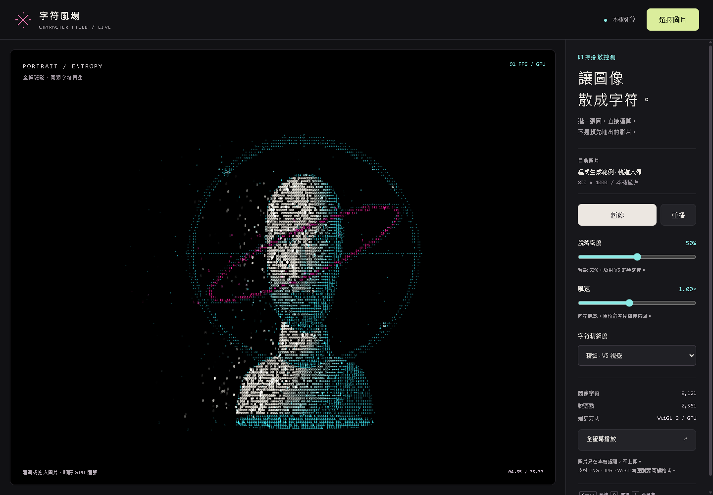

# 字符風場 · ASCII Wind Player

**選一張圖，讓字符從原位脫落、隨風飄散，再緩慢長回。**

離線、免安裝的 WebGL 2 即時播放器。動畫由 GPU 每幀演算，不是預先輸出的 MP4，也不是在照片上疊一層飄字。



## 開始使用

1. 下載 [v0.1.0 發行版](https://github.com/C-EXCITE-STUDIO/ascii-wind-player/releases/tag/v0.1.0)，**完整解壓縮**。
2. Windows：雙擊 `start_player.cmd`，以 Chrome／Edge 獨立視窗開啟。
3. 按「選擇圖片」，或將圖片拖到播放區。
4. 調整脫落密度、風速及字符精細度。

也可以直接雙擊 `index.html`，在一般瀏覽器分頁使用。移動程式時請保留整個資料夾，不要只搬走 HTML。

**使用播放器不需要 Python、Node.js、FFmpeg、伺服器或 API 金鑰。** Node.js 只用於開發測試。Windows 啟動器使用系統內建 PowerShell，不修改執行原則或系統設定。

## 視覺與操作

- 電白、冰青與螢光洋紅的高對比字符。
- 全圖均勻、持續斑駁地掉落，不是局部區塊輪流消失。
- 每個來源字符只有一個粒子身份：離開後原位留空，稍後緩慢再生。
- 預設 **50% 脫落密度**，保留原圖辨識度；滑桿可調整至 0–100%。
- 向左風場與輕微上下擾動；風速可調至 0.25–2.00 倍。
- 三檔精細度、暫停／繼續、重播、全螢幕及窄視窗排版。
- 可讀取 PNG、JPG、WebP 等瀏覽器支援的圖片；單檔上限 64 MB、解碼後上限一億像素。

| 快捷鍵 | 功能 |
|---|---|
| `Space` | 暫停／繼續 |
| `R` | 從頭播放 |
| `F` | 全螢幕 |
| `O` | 選擇圖片 |

深黑背景、清楚輪廓與明暗分離的圖片最容易得到清晰結果。圖片太暗或完全透明時會顯示錯誤，不會用另一張圖冒充結果。

## 隱私與範例

- 圖片透過瀏覽器 File／Blob 與 Canvas 在本機記憶體內處理。
- 沒有上傳、分析追蹤、CDN、外部字型或遠端 API。
- 網頁設定 `connect-src 'none'`，不建立網路連線。
- 內建範例是 `demo-image.js` 內的原創幾何 SVG，**不是開發時的私人測試照片**。
- 私人素材及原始測試紀錄應放在 `.local/` 或 `reports/`，兩者均已排除於 Git。

## 相容性與已知限制

本版實測環境為 Windows 11、Chrome 與 Intel Iris Xe。需要 WebGL 2 及瀏覽器硬體加速；其他作業系統與瀏覽器尚未逐一實測。

- 幀率會受 GPU、視窗大小、螢幕更新率與精細度影響，不保證每台電腦相同。
- 遵循系統的「減少動態效果」偏好；若啟動時暫停，按「繼續播放」即可。
- GPU 環境中斷時會暫停並提示重新整理，本版不自動重建繪圖環境。
- 目前專注即時播放，**尚未提供影片錄製／匯出**。
- 這是從視覺效果需求獨立實作的播放器，不宣稱還原任何原作者未公開的製作程式。

## 開發與驗證

使用 Node.js 22 或更新版本，無需安裝 npm 套件：

```bash
node --test tests/core.test.cjs tests/package.test.cjs
node --check core.js
node --check renderer.js
node --check app.js
node --check demo-image.js
```

`package.json` 也提供 `npm test` 與 `npm run check`。GitHub Actions 在 Windows 與 Linux 執行核心／封裝測試；Windows 專用啟動器測試在 Linux 會跳過。

- [技術架構與視覺原則](docs/技術架構.md)
- [驗證紀錄與證據範圍](docs/驗證紀錄.md)
- [版本紀錄](CHANGELOG.md)
- [貢獻與發版方式](CONTRIBUTING.md)

## 授權

本倉庫目前未附開源授權條款；公開原始碼不等同授予再散布或商業使用授權。
